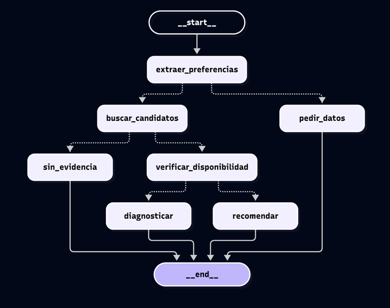

# Informe: asistente conversacional para elegir un vestuario

Diplomatura Universitaria en Inteligencia Artificial · Módulo 6 · Grupo 9
Integrantes: _(completar)_

## 1. Problema, usuarios y alcance

**Problema.** Una persona que va a un evento quiere un saco que combine con las prendas que ya tiene,
dentro de su talle y presupuesto, y necesita poder **verificar** lo que se le recomienda.

**Usuario.** Una persona que describe en lenguaje natural el evento, su talle, su presupuesto y sus
prendas propias, y puede pedir alternativas o cambiar una preferencia durante la conversación.

**Alcance.** Prueba de concepto académica con datos simulados.
- Recomienda **un saco** del catálogo (8 sacos), verificado en talle, stock y precio.
- El catálogo incluye 2 camisas, pero el asistente todavía no las recomienda (ver limitaciones).
- El presupuesto se aplica al saco.

## 2. Arquitectura

```mermaid
flowchart TD
    U(["Mensaje del usuario"]) --> B["extraer_preferencias<br/>(LLM: datos estructurados)"]
    B --> C{"¿Faltan datos?"}
    C -- sí --> D["pedir_datos"]
    C -- no --> E["buscar_candidatos<br/>(RAG: fichas y guías)"]
    E --> F{"¿Hay evidencia<br/>suficiente?"}
    F -- no --> G["sin_evidencia"]
    F -- sí --> H["verificar_disponibilidad<br/>(SQLite: talle, stock, precio)"]
    H --> I{"¿Hay una opción<br/>viable?"}
    I -- sí --> J["recomendar<br/>(LLM explica + ficha verificable)"]
    I -- no --> K["diagnosticar<br/>(identifica la restricción y pregunta)"]
    D --> R(["Respuesta"])
    G --> R
    J --> R
    K --> R
    
     -> guardamos la imagen del grafo
```

El LLM se usa solo donde aporta lenguaje: **entender el mensaje** y **redactar la explicación**. Todo
lo verificable (búsqueda, talle, stock, precio, decisión del camino) lo hace código normal. La ficha
final (ID, talle, precio, unidades) la arma el código desde la base de datos, no el LLM, por lo que
esos datos no pueden salir inventados.

### Qué función cumple cada tecnología

| Tecnología | Función |
|---|---|
| **LangChain** (`langchain-core`, `langchain-groq`, `langchain-huggingface`) | Conexión con el LLM, salida estructurada, documentos y vector store, definición de tools |
| **LangGraph** | Orquesta el flujo como grafo con estado, decisiones (aristas condicionales) y un *checkpointer* que guarda el estado de cada conversación |
| **Groq** (`openai/gpt-oss-120b`) | LLM para extraer preferencias y redactar la explicación |
| **sentence-transformers** (`paraphrase-multilingual-MiniLM-L12-v2`) | Embeddings locales en español (Groq no ofrece embeddings) |
| **SQLite** | Fuente estructurada de talle, stock y precio |
| **Streamlit** | Interfaz de prueba para la cátedra |

**Alternativas descartadas.**
- *DeepAgents:* el flujo es acotado y conocido de antemano. Un grafo explícito es más fácil de verificar
  que un agente con planificación libre.
- *Chroma / FAISS:* el corpus es de 13 documentos; `InMemoryVectorStore` no agrega dependencias y se
  reconstruye al iniciar.
- *Base NoSQL:* el catálogo es tabular y se consulta por producto y talle; SQLite alcanza. El enunciado
  deja NoSQL como opcional.
- *Tools con selección libre del LLM dentro del grafo:* ver sección 5.

## 3. Datos y persistencia

**Procedencia.** Datos simulados creados por el equipo a partir del prototipo de interfaz del proyecto
(`PROTOTYPE-vestuario-fiesta-ui`): 8 sacos y 2 camisas, con descripción, precio y stock por talle, y 3 guías
de estilo. No hay datos reales de ninguna empresa.

| Dato | Almacenamiento | Quién lo consulta |
|---|---|---|
| Precio y stock por talle | SQLite (`data/vestuario.db`), tablas `productos` y `stock` | `db.py` (`consultar_stock`, `filtrar_productos`) |
| Texto de fichas y guías | Índice vectorial en memoria, armado desde los JSON | `rag.py` |
| Estado de la conversación | *Checkpointer* de LangGraph (en memoria), por `thread_id` | `graph.py` |

La base se crea desde `data/productos.json` con `python -m src.db`. **Operación concreta de persistencia:**
el estado guardado permite que, si el usuario pide "otra alternativa" o sube el presupuesto, el sistema
recuerde talle, evento y prendas propias, y no vuelva a proponer lo descartado.

## 4. RAG

- **Corpus:** 10 fichas (`nombre + descripción`) y 3 guías, en dos índices separados.
- **Qué se indexa:** solo texto descriptivo. **Precio y stock no se indexan**, para que el buscador no
  pueda devolver datos desactualizados; esos datos salen siempre de SQLite.
- **Recuperación:** embeddings normalizados y similitud coseno; las fichas se filtran por categoría.
- **Evidencia insuficiente:** si ningún resultado supera el umbral, la búsqueda devuelve una lista vacía y el
  grafo toma la ruta `sin_evidencia` (no inventa una recomendación).

**Calibración de umbrales** (con 6 consultas, ver `python -m src.rag`):

| | Mayor puntaje en consultas irrelevantes | Menor puntaje en consultas relevantes | Umbral elegido |
|---|---|---|---|
| Fichas | 0.373 | 0.514 | **0.45** |
| Guías | 0.290 | 0.346 | **0.33** |

En guías el margen es estrecho: la GUIA-03 (verano) puntúa 0.288 para una consulta relevante y 0.290
para una irrelevante, por lo que ningún umbral las separa. Con 0.33 se pierde esa guía en algunos casos.

## 5. Decisiones de implementación

1. **El LLM entiende y redacta; el código decide y verifica.** Garantiza que ID, talle, precio y stock
   coincidan con la base.
2. **Grafo explícito en vez de que el LLM elija tools.** Se probó la selección de tools por el LLM
   (`python -m src.tools`): coincidió con lo esperado en 4 de 5 pedidos, pero en "Busco un saco para un casamiento de noche"
   llamó solo a la búsqueda de guías y no a la de productos. Para el flujo principal se prefirió un camino
   controlado. `tools.py` queda como evidencia de esa prueba y expone las mismas funciones como herramientas.
3. **La temporada es un filtro sobre el dato estructurado.** La búsqueda semántica la distingue mal:
   para "algo abrigado para una fiesta en invierno", un saco de lino de verano (SAC-0417, 0.547) rankeó
   por encima de uno de lana (SAC-0187, 0.528).
4. **Diagnóstico de restricciones.** Cuando no hay opción viable, el sistema identifica qué restricción
   bloquea (presupuesto, temporada o talle), ofrece las mejor rankeadas con sus precios reales y pregunta
   qué cambio acepta.
5. **Distinción propias / catálogo.** La respuesta lista aparte "prendas que ya tenés" y "del catálogo".

## 6. Evaluación

**Método.** Verificaciones automáticas (`evaluacion/run_eval.py`) que leen el texto de la respuesta y lo
comparan con la base de datos y las guías. No se usó LLM como evaluador. Cada verificación se agrupa en
una de las cuatro dimensiones: acción adecuada, evidencia pertinente, respuesta apoyada en la evidencia
y extracción del pedido.

**Archivos:** `evaluacion/casos.json` (casos), `evaluacion/run_eval.py` (validación),
`evaluacion/resultados.md` y `.json` (entrada, esperado, salida observada y verificaciones de cada caso).

| Caso | Entrada | Esperado | Observado | Resultado |
|---|---|---|---|---|
| C1 Típico | Casamiento de noche, verano, talle 50, pantalón negro | Saco de verano con stock en talle 50, datos y fuentes reales; conserva "de noche"; recupera GUIA-07 | En la corrida revisada recomienda SAC-0512, $109.900, 4 u., con ficha coincidente con la base | ✅ PASS |
| C2 Dato faltante | "Quiero un saco para una fiesta" | No recomienda; pide talle y época | Ruta `pedir_datos` | ✅ PASS |
| C3 Evidencia insuficiente | Disfraz de dinosaurio inflable | Declara evidencia insuficiente, sin inventar productos | Ruta `sin_evidencia`, sin candidatos sobre el umbral | ✅ PASS |
| C4 Restricción incumplida | Talle 56, tope $120.000 | Identifica el presupuesto y pregunta qué cambio acepta | Ruta `diagnosticar`, nombra el presupuesto y cita precios reales | ✅ PASS |
| C5 Adecuación al evento | Igual que C1 con otra redacción | Saco que no sea beige ni blanco de noche | Recomienda SAC-0512 (beige) | ❌ FAIL |

**Resultado: 4 de 5 casos aprobados.** El texto completo de cada salida está en `evaluacion/resultados.md`.

### Hallazgos concretos

1. **El ranking semántico no entiende negaciones (C5, hallazgo principal).** Con el mejor candidato
   (SAC-0417) agotado en talle 50, el sistema recomienda el saco beige SAC-0512, cuya propia ficha dice
   "poco recomendable de noche" y que la GUIA-12 desaconseja. La búsqueda detecta el tema ("de noche",
   "pantalón negro") pero no la polaridad. C1 muestra la misma recomendación y pasa porque sus
   verificaciones miden consistencia de datos, no adecuación: **un caso en verde no implica una buena
   recomendación**, por eso se agregó C5.
2. **El extractor del LLM recortaba el evento.** En una primera versión guardaba `'casamiento'` en lugar
   de `'casamiento de noche'`, lo que cambiaba la consulta al RAG y favorecía sacos diurnos. Se corrigió
   en el prompt y se verificó: en C1 el evento queda como `'casamiento de noche'` (verificación
   "el evento conserva el detalle").
3. **La explicación del LLM racionalizaba.** Ante una opción poco adecuada inventaba un contexto para
   justificarla (la llamaba "ideal para una boda de día"). Se agregó la regla de señalar las salvedades;
   ahora indica que "es lo mejor disponible, pero no el más adecuado".

### Revisión manual (C1)

Se revisó a mano la respuesta de C1. Las afirmaciones sobre el bajo contraste con el pantalón negro y la
recomendación de evitar colores claros se apoyan en la ficha SAC-0512 y en la GUIA-12. La frase "puede
resultar poco formal" es una inferencia del modelo que no figura en las fuentes. La advertencia es
correcta, pero el sistema igualmente ubicó esa opción primera: el problema está en el ranking, no en la
redacción.

## 7. Limitaciones

- **Ranking por similitud semántica:** no distingue negaciones, y cuando se agotan los buenos candidatos
  puede recomendar uno desaconsejado (C5). La mejora natural es un puntaje de compatibilidad con reglas
  (color, momento del día) para comparar contra el orden semántico; no está implementada.
- **Solo se recomienda un saco.** Las camisas están en el catálogo pero no se recomiendan ni se maneja su talle.
- **Datos simulados y pequeños:** 10 productos y 3 guías; los umbrales se calibraron con solo 6 consultas.
- **Estado en memoria:** la conversación se pierde al reiniciar la aplicación.
- **Dependencia del LLM:** la extracción de preferencias puede variar con la redacción del usuario.
  El contexto entre turnos se comprobó manualmente en la interfaz y no tiene una verificación automática.
- **Evaluación acotada:** 5 casos, sin LLM como evaluador.
- **Compatibilidad de entorno:** en Mac Intel hay que fijar `transformers<4.50` y `numpy<2`.
